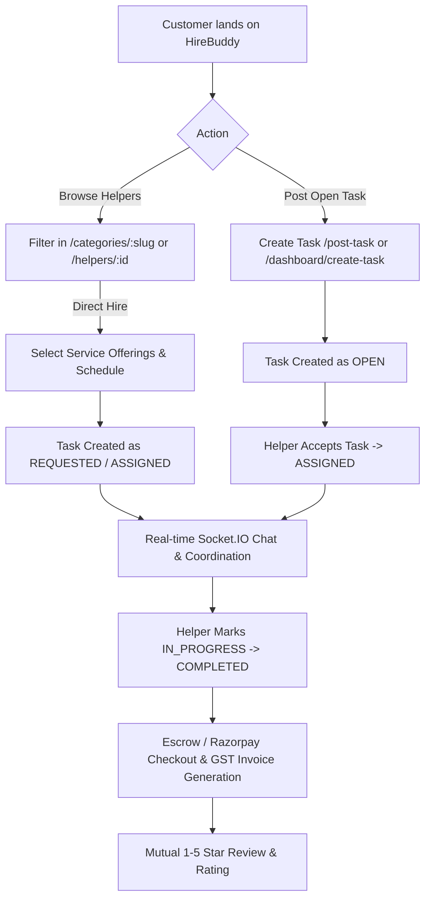
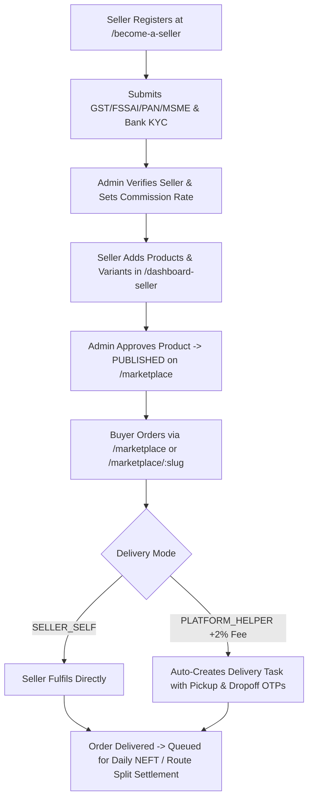

# HireBuddy — Product Context

## Problem Statement & Context
Everyday micro-tasks and regional commerce face four structural barriers:
1. **Too small for agencies**: Traditional home-service agencies impose high minimum callout fees and rigid booking windows for 15–30 minute tasks.
2. **Too urgent to delay**: Errands like pharmacy runs, elder clinic escort, or urgent repairs require assistance within hours.
3. **Disconnected local producers**: Renowned regional manufacturers (e.g., Meerut sports goods, scissors, gajak, handloom) lack a unified hyperlocal D2C storefront with instant local delivery.
4. **Trust & compliance deficit**: Inviting strangers into homes or transacting online requires rigorous KYC verification, OTP handoffs, escrow protection, and compliant GST/TDS accounting.

HireBuddy unifies **hyperlocal task services** and a **local manufacturers marketplace** on a single trust-first, tax-compliant platform.

---

## User Journeys & Core Workflows

### 1. Discovery, SEO & Landing Experience
- Visitors land on `/` with city/locality selection, popular categories, and an optional **Daily Promotional Popup** (`DailyPromotionalPopup.js`) configurable from the Admin CMS.
- Dedicated SEO landing hubs:
  - **Services Hub** (`/services` & `/services/[serviceSlug]`): Rich service pages with sub-services, pricing, FAQs, and nearby verified helpers.
  - **Locations Hub** (`/locations` & `/locations/[locationSlug]`): Hyperlocal neighborhood guides and service-location matrix landing pages.
  - **Categories Catalog** (`/categories/[slug]`): Real-time search, sub-service checkboxes, rating/price/availability filters, and 1-click **Hire me**.
  - **Public Helper Profiles** (`/helpers/[id]`): SEO-friendly slugs, trust badges, custom service offerings, reviews, and direct booking.

### 2. Task Poster (Customer) Journey

### 3. Tasker / Helper Journey
- **Onboarding & KYC**: Register as Helper (`/become-a-helper`), configure skills, hourly rates, and structured `serviceOfferings` (`/dashboard-tasker/profile/edit`), and upload ID + address proof documents.
- **Partner Subscription Pass**: Activate daily (₹5/day) or monthly (₹99/month) Partner Pass via Wallet or Razorpay to accept tasks.
- **Task Execution & Earnings**: Browse open tasks (including auto-created Marketplace delivery tasks), coordinate via Socket.IO chat, complete work, and manage bank accounts, tax profiles (PAN/GSTIN), TDS certificates, and payouts (`/dashboard-tasker/earnings`).

### 4. Meerut Manufacturers Marketplace & Seller Journey

### 5. Standalone Admin Portal (`admin/`)
- Dedicated Vite + React 19 application with specialized operational dashboards:
  - **Overview & Analytics** (`DashboardPage`, `AnalyticsPage`, `SearchLogsPage`)
  - **User, Helper & KYC Management** (`UsersPage`, `HelpersPage`, `VerificationsPage`, `TasksPage`, `CategoriesPage`)
  - **Marketplace Operations** (`MarketplacePage`: Seller KYC verification, product approvals, order monitoring, NEFT settlement batches)
  - **Finance & Tax Governance** (`FinanceTaxDashboardPage`: Commission rules, CA tax rule review, GST/TDS/TCS registers, double-entry ledger journals, payouts, refunds, reconciliation)
  - **SEO & CMS Suite** (`SeoCmsDashboardPage`: Static/service/location SEO configs, blog posts, automated SEO audits, and Daily Promotional Popup ad manager)

---

## Trust, Safety & Financial Compliance Framework
1. **Multi-Tier KYC**:
   - Helpers: Government ID + Address proof (`UNVERIFIED` → `PENDING` → `VERIFIED` / `REJECTED`) + Public Profile approval gate (`isPublicProfileApproved`).
   - Sellers: PAN, GSTIN, FSSAI (for food/sweets), MSME/Udyam, and bank verification.
2. **Closed-Loop Escrow & OTP Handoffs**:
   - Marketplace helper deliveries enforce 4-digit `pickupOtp` (at seller shop) and `deliveryOtp` (at buyer doorstep).
3. **CA-Reviewed Tax & Ledger Integrity**:
   - Immutable paise-precision pricing and tax snapshots on every `Task` and `Payment`.
   - Automated calculation of CGST/SGST/IGST, Section 9(5) liability, Section 52 TCS, and Section 194-O / 206AA TDS withholdings.
   - Double-entry `LedgerJournal` and `LedgerEntry` tracking across asset, liability, revenue, and expense accounts.
