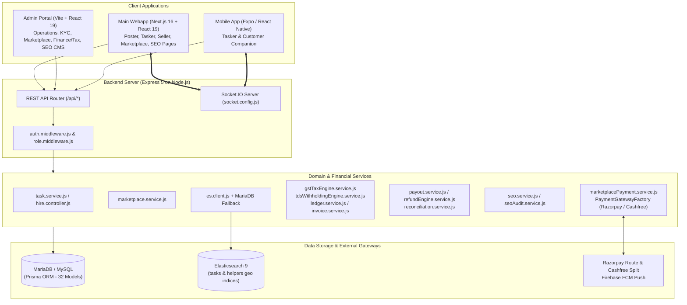

# HireBuddy — System Patterns & Architecture

## High-Level Multi-App Architecture



---

## Repository & Directory Structure

### 1. Backend (`backend/`)
```
backend/
├── prisma/
│   ├── schema.prisma                        # 32 models across Core, Marketplace, Finance/Tax, SEO/CMS
│   └── migrations/                          # SQL migration history
├── scripts/
│   ├── create-indices.js                    # Elasticsearch index mapping setup
│   ├── reindex-all.js                       # Full MariaDB-to-ES synchronization
│   ├── seed-categories.js                   # Category & sub-services seeder
│   └── seed-helpers.js                      # Realistic helpers seeder
├── tests/
│   ├── marketplace-payment-tax.test.js      # Unit/integration tests for GST, TDS/TCS, commissions, ledger
│   └── seo-and-e2e.test.js                  # E2E tests for SEO CMS, sitemaps, marketplace, and flows
└── src/
    ├── app.js                               # Express 5 app, CORS, static uploads, route mounting
    ├── server.js                            # HTTP server & Socket.IO bootstrap
    ├── payments/                            # Pluggable Payment Gateway Architecture
    │   ├── PaymentGatewayFactory.js
    │   └── providers/
    │       ├── PaymentGatewayInterface.js
    │       ├── RazorpayRouteProvider.js
    │       └── CashfreeSplitProvider.js
    ├── controllers/                         # HTTP handlers (auth, user, helper, task, hire, category, marketplace, payment, message, review, notification, upload)
    ├── routes/                              # Express routers including adminFinance, helperFinance, marketplace, seo, support, search
    ├── services/                            # Domain logic, tax engines, double-entry ledger, invoicing, SEO audit, ES client, Firebase FCM
    └── utils/
        ├── cryptoVault.js                   # AES-256-GCM encryption & masking for PAN / bank account numbers
        ├── jwt.js                           # JWT signing & verification
        └── prisma.js                        # PrismaClient singleton with MariaDB adapter
```

### 2. Main Web Application (`webapp/app/`)
```
webapp/app/
├── page.js                                  # Homepage with hero, category grid, location selector, DailyPromotionalPopup
├── sitemap.js & robots.js                   # Dynamic XML sitemap & robots.txt backed by SEO service
├── marketplace/                             # Meerut Manufacturers Marketplace (/marketplace & /marketplace/[slug])
├── become-a-seller/ & dashboard-seller/     # Seller onboarding & storefront/order/settlement dashboard
├── become-a-helper/ & dashboard-tasker/     # Helper onboarding, tasks feed, profile/offerings editor, earnings
├── dashboard/                               # Customer dashboard, create-task, my-tasks, helpers, notifications, settings
├── categories/[slug]/                       # Interactive category catalog & multi-filter helper search
├── services/ & services/[serviceSlug]/      # SEO service landing pages
├── locations/ & locations/[locationSlug]/   # Hyperlocal city/neighborhood SEO landing pages
├── helpers/[id]/                            # Public SEO-indexed helper profile page with service offerings
├── blog/                                    # Editorial blog hub & articles
├── lib/seo.js                               # Metadata builder, canonical URLs, JSON-LD schema generators
└── components/                              # Reusable UI, layout headers, HireButton, DailyPromotionalPopup, API services
```

### 3. Standalone Admin Portal (`admin/src/`)
```
admin/src/
├── App.jsx                                  # React Router v7 admin routes & AuthContext protection
├── pages/
│   ├── DashboardPage.jsx                    # Platform KPIs & live activity
│   ├── UsersPage.jsx & HelpersPage.jsx      # User/Helper management, block controls, profile approvals
│   ├── VerificationsPage.jsx                # Helper ID/Address KYC & Partner Pass verification queue
│   ├── TasksPage.jsx & CategoriesPage.jsx   # Task oversight & dynamic Category CRUD
│   ├── MarketplacePage.jsx                  # Seller KYC, product approval, orders, NEFT settlements
│   ├── FinanceTaxDashboardPage.jsx          # Commission/Tax rules, CA review, GST/TDS/TCS, Ledger, Payouts, Refunds
│   ├── SeoCmsDashboardPage.jsx              # SEO page configs, Service/Location pages, Blog CMS, SEO Audit, Promotional Popup Ad config
│   ├── SearchLogsPage.jsx                   # User search analytics & zero-result tracking
│   ├── AnalyticsPage.jsx & SettingsPage.jsx # Platform metrics & system configuration
└── services/api.js                          # Admin REST client
```

### 4. Mobile App (`mobile/`)
- Expo ~51 / React Native 0.74 companion app (`App.js`, `src/api/client.js`) connecting to the same Express & Socket.IO backend.

---

## Core Architectural Patterns

### 1. Paise-First Immutable Financial & Tax Snapshots
- All monetary values across all 32 Prisma models are stored in **integer paise** (`Int` / `BigInt`) and basis points (`bps`, where `100 bps = 1.00%`).
- Every booking/payment calculates an immutable snapshot via `pricingBreakdown.service.js`, `commission.service.js`, `gstTaxEngine.service.js`, and `tdsWithholdingEngine.service.js`.
- **Classification Support**:
  - `ORDINARY_MARKETPLACE`: Helper is supplier; platform charges commission + 18% GST and collects Section 52 TCS & deducts Section 194-O TDS.
  - `SECTION_9_5`: Platform is liable for service GST under CGST Section 9(5).
  - `PRINCIPAL_PROVIDER`: Platform acts as principal supplier.

### 2. Double-Entry Accounting Ledger (`ledger.service.js`)
- Financial events (`PAYMENT_CAPTURED`, `PAYOUT_SETTLED`, `REFUND_ISSUED`, `CHARGEBACK`, `REVERSAL`) generate balanced `LedgerJournal` and `LedgerEntry` rows where `totalDebitPaise === totalCreditPaise`.

### 3. Sensitive Data Vault (`cryptoVault.js`)
- Helper PAN numbers and bank account numbers are never stored in plain text; they are encrypted via AES-256-GCM (`panEncrypted`, `accountNumberEncrypted`) alongside masked display strings (`XXXXX1234F`, `XXXXXXXX4321`) and SHA-256 hashes.

### 4. Marketplace Auto-Task Delivery Integration
- When a customer buys from `/marketplace` and selects `PLATFORM_HELPER` delivery (+2% delivery fee), `marketplace.service.js` automatically spawns a linked `Task` (`deliveryTaskId`) with 4-digit `pickupOtp` and `deliveryOtp` for local helpers to fulfill.

### 5. Hybrid Search with Non-Blocking Failover
- `/api/search/*` queries Elasticsearch 9 (`tasks` and `helpers` indices with `geo_point` distance sorting) first and transparently falls back to Prisma/MariaDB queries if Elasticsearch is offline, logging every search to `SearchLog`.

### 6. Database-Driven Technical SEO & CMS
- Next.js `generateMetadata`, `sitemap.js`, and `robots.js` dynamically query `/api/seo/*` (`ServiceLocation`, `ServiceLocationPage`, `SeoPageConfig`, `BlogPost`, `Category`) with automatic JSON-LD structured data (`LocalBusiness`, `Service`, `FAQPage`, `BreadcrumbList`, `Article`) and an automated `seoAudit.service.js` scoring engine.
